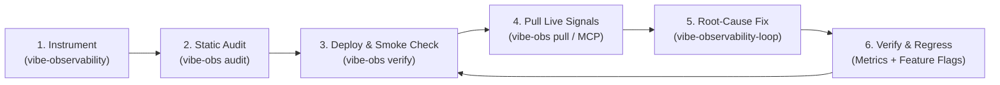

# vibe-observability

[](https://github.com/realchendahuang/vibe-observability/actions/workflows/ci.yml)
[](https://github.com/realchendahuang/vibe-observability/releases)
[](./LICENSE)

[English](./README.md) | [简体中文](./README_ZH.md)

**Vendor-neutral observability guardrails, zero-dependency CLI verifiers, and closed-loop AI Agent Skills for Vibe Coding & modern full-stack projects.**

Works across **Web SPAs (Vite 8 / React / TanStack / Hono / Better Auth / Oxc)**, **Cloudflare Edge (Workers / D1 / KV / Queues / R2)**, **Self-Hosted High-Concurrency Backends (Go / Gin / Caddy / Pigsty / Prometheus / `pgmq` / OpenTelemetry)**, **Desktop & Native Apps (Electron / Wails v3 / Tauri 2 / Swift / Kotlin)**, **SSR Meta-Frameworks (Next.js / Nuxt / SvelteKit / Astro)**, and **Python + `uv` Automation Jobs**.

Compatible with **Antigravity**, **Claude Code**, **Codex**, **Cursor**, and any agent supporting the open `SKILL.md` standard.

---

## Try It in 3 Seconds (Zero Install via `uvx`)

You don't even have to install the Agent Skills first — audit any local repo or smoke-test a live deployment directly with zero third-party runtime dependencies:

```bash
# 1. Static audit any codebase (catches 16 real observability pitfalls)
uvx --from git+https://github.com/realchendahuang/vibe-observability vibe-obs audit .

# 2. Live post-deploy smoke test (catches auth redirects on /ingest & leaked .js.map files)
uvx --from git+https://github.com/realchendahuang/vibe-observability vibe-obs verify https://app.example.com

# 3. Pull a compact read-only production brief (Sentry + PostHog + Clarity + Prometheus + Jobs)
uvx --from git+https://github.com/realchendahuang/vibe-observability vibe-obs pull --days 7
```

### What It Actually Catches (Real CLI Output)

```text
$ vibe-obs audit ./my-web-app --strict
Vibe Observability Audit — /workspace/my-web-app
====================================================================
Files scanned : 48
Providers     : sentry, posthog, ga4, clarity
Stack hints   : vite, oxlint, backend
Score         : 10/100  (CRITICAL=0 HIGH=3 MEDIUM=3 LOW=1 INFO=0)

[HIGH] OBS-002: Dual session-replay conflict: PostHog Replay + Microsoft Clarity both active
  Fix : Set `disable_session_recording: true` in `posthog.init(...)`, or drop Clarity.
[HIGH] OBS-003: Unbounded Sentry tracing sample rate (100%)
  Fix : Use an environment-aware sample rate such as `0.1` in production and `0` in dev.
[HIGH] OBS-004: Potential PII forwarded to GA4 or Sentry default PII capture enabled
  Fix : Set `sendDefaultPii: false` in Sentry and never pass email/phone/name into `gtag()`.

$ vibe-obs verify https://app.example.com --strict
[PASS]     LIVE-001: Homepage healthy (HTTP 200) (118ms)
[PASS]     LIVE-002: Health probe healthy (HTTP 200 in 24ms)
[HIGH]     LIVE-003: PostHog proxy redirected (HTTP 307 -> /login)
[CRITICAL] LIVE-005: Public source maps exposed (1 file(s)) -> /assets/app.js.map
```

---

## Why This Exists

Official vendor plugins tell you how to install *their* SDK. They will **not** warn you that stacking PostHog Replay + Microsoft Clarity + Sentry Replay wrecks Core Web Vitals, that GA4/Clarity break Electron/Wails/Tauri trust, that missing `ctx.waitUntil()` on Cloudflare Workers silently drops 100% of server events, or that your existing Pigsty stack already runs Prometheus + Grafana + Loki.

| Common Vibe-Coding Trap | How `vibe-observability` Solves It |
| :--- | :--- |
| **Dual Session-Replay Tax** — Overlapping DOM observers hurt LCP/INP and burn quota. | **7 Runtime-Matched Profiles** (`core`, `marketing`, `full-deduped`, `ai-app`, `selfhosted-infra`, `desktop-native`, `batch-jobs`). Only one replay engine runs at a time. |
| **Wrong Tool for the Runtime** — Web trackers in desktop/native apps; `@sentry/node` or unflushed PostHog in Cloudflare Workers. | **6 Progressive-Disclosure Stack Adapters** tailored to each runtime's actual failure modes. |
| **Deployment-Time Blind Spots** — Auth middleware redirecting `/ingest` to `/login`, or `.js.map` leaking source publicly. | **`vibe-obs verify`** probes `/api/health`, `/ingest`, `/monitoring`, CSP, and `.js.map` leaks right after deploy. |
| **AdBlockers, PII Leaks & Surprise Bills** — 30–50% traffic blocked; GA4 PII bans; infinite `useEffect` loops. | First-party proxies (Hono/Workers, Caddy, framework rewrites), PII scrubbing, `oxlint` facade rules, burst guards, and bounded sampling. |
| **Unverified "AI Optimization" Loops** — Guessing fixes on noisy dashboards without checking outcomes. | Companion **`vibe-observability-loop`** pulls real signals via **`vibe-obs pull`** / MCP, traces root causes in code, and mandates post-deploy verification contracts. |

---

## The End-to-End Closed Loop



---

## Reproducible Benchmark (`evals/`)

Run `python3 evals/run_benchmark.py` locally to reproduce this exact comparison between common naive AI-generated setups and the bundled self-contained starters:

| Category | Scenario | Audit Score | Critical/High | Triggered Rules |
| :--- | :--- | :---: | :---: | :--- |
| Before (Naive) | Naive Web App (unbounded 4-SDK dump) | **0/100** | 3 | OBS-002, OBS-003, OBS-004, OBS-005, OBS-006, OBS-007, OBS-008, OBS-009, OBS-011 |
| Before (Naive) | Naive Cloudflare Worker (Node SDK + no `waitUntil`) | **25/100** | 3 | OBS-003, OBS-013, OBS-016, OBS-008, OBS-010, OBS-011 |
| Before (Naive) | Naive Desktop Tauri App (web Clarity + GA4) | **50/100** | 2 | OBS-004, OBS-012, OBS-008, OBS-011 |
| After (`vibe-observability`) | Starter: `vite-tanstack-hono` | **100/100** | 0 | None (PASS) |
| After (`vibe-observability`) | Starter: `cloudflare-workers-hono` | **100/100** | 0 | None (PASS) |
| After (`vibe-observability`) | Starter: `go-gin-caddy` | **100/100** | 0 | None (PASS) |
| After (`vibe-observability`) | Starter: `python-uv-job` | **100/100** | 0 | None (PASS) |
| After (`vibe-observability`) | Starter: `nextjs-app-router` | **100/100** | 0 | None (PASS) |

---

## Three Zero-Dependency CLI Tools (Python 3.9+ Stdlib)

Every tool works either via **`vibe-obs <cmd>`** (`uvx` / installed package) or directly as a standalone file inside `skills/*/scripts/`.

1. **`audit` (`audit_observability.py`)** — Static auditor covering `OBS-001`–`OBS-016` across TS/JS, Vue, Svelte, Go, Python, Rust, Swift, Kotlin, Wrangler, Caddyfile, and Oxc.
   - Supports CI gates (`--strict` / `--fail-on HIGH`), JSON output (`--json`), and rule suppression via `--ignore OBS-006B,OBS-010` or an optional project-root `.vibe-observability.json`:
     ```json
     {
       "ignore": ["OBS-006B", "OBS-010"],
       "exclude_paths": ["legacy/", "scripts/scratch/"]
     }
     ```
2. **`verify` (`verify_live.py`)** — Post-deploy live verifier checking homepage & HTTPS, `/api/health` or `/healthz`, `/ingest/static/array.js` (flags 302/307 auth redirects and HTML SPA fallbacks), `/monitoring` tunnel, public `.js.map` source map leaks (`CRITICAL`), and CSP headers.
3. **`pull` (`pull_signals.py`)** — Strictly read-only signal aggregator fetching Sentry top unresolved issues, PostHog HogQL top events + `$ai_generation` LLM latency/tokens, Microsoft Clarity live insights (Rage/Dead Clicks), Prometheus/Pigsty PromQL checks (`up == 0`, `pgmq` backlog/age), and local Python scraper JSONL anomalies — never printing tokens.

---

## Observability Profiles

| Profile | Stack | Best For |
| :--- | :--- | :--- |
| **`core`** *(default Web)* | Sentry + PostHog + Structured Logs & `/health` | Vite/React/TanStack/Hono, Next.js/Nuxt, SaaS MVPs |
| **`marketing`** | Sentry + GA4 + MS Clarity + `/health` | Landing pages, SEO/content sites, Google Ads funnels |
| **`full-deduped`** | Sentry + PostHog *(replay OFF)* + GA4 + MS Clarity *(replay ON)* + Logs | Growth products needing both product funnels/flags and Ads + free heatmaps |
| **`ai-app`** | `core` + LLM Generation Telemetry (`$ai_generation`, TTFT, tokens, cost, feedback) | AI copilots, agents, RAG apps |
| **`selfhosted-infra`** | Go `log/slog` + Sentry + `/metrics` (Pigsty/Prometheus/Loki) + Caddy `/ingest` + `pgmq` alerts | Dedicated servers, Go + Gin + Docker + Caddy + Pigsty (`pgmq`/Valkey/RustFS) |
| **`desktop-native`** | Native Sentry (`@sentry/electron`, `sentry-go`, `sentry` Rust, `sentry-cocoa`/`MetricKit`, `sentry-android`) + Rotating local logs + Opt-out events | Electron, Wails v3, Tauri 2, Swift (macOS/iOS), Kotlin (Android) — **NO GA4/Clarity** |
| **`batch-jobs`** | `structlog` JSON + Sentry Crons + Run Summary & silent volume-drop alerts | Python + `uv` scrapers, Ego Lite automation, ETL/cron workers |

---

## Install Agent Skills

Each skill directory under `skills/` is **100% self-contained** (references, starter examples, and zero-dependency scripts all live inside the skill folder).

### Option 1: Clone & Run `install.sh` (Recommended)

```bash
git clone https://github.com/realchendahuang/vibe-observability.git
cd vibe-observability

./install.sh --target antigravity --symlink   # ~/.gemini/config/skills
./install.sh --target claude --symlink        # ~/.claude/skills
./install.sh --target codex --symlink         # ~/.codex/skills
./install.sh --target cursor --symlink        # ~/.cursor/skills
./install.sh --target all --symlink           # All global agent roots

# Project-local (.agents/skills inside one repo)
./install.sh --target project --project-dir /path/to/your-app --copy
```

### Option 2: Install via `skills` CLI

```bash
npx skills add realchendahuang/vibe-observability
```

---

## Example Prompts

- **Wire a new project**: *"Use `vibe-observability` to set up observability for this repo. Pick the right profile for our stack, add the typed facade, and pass `audit_observability.py --strict`."*
- **Audit an existing codebase**: *"Run a `vibe-observability` audit on this repository and fix every CRITICAL/HIGH privacy, billing, proxy, or replay issue."*
- **Post-deploy verification**: *"Run `verify_live.py https://app.example.com --strict` and fix any redirect or source map leak."*
- **Close the AI loop**: *"Use `vibe-observability-loop` to pull our last 7 days of Sentry, PostHog, and Clarity signals, trace the top 3 root causes in the code, and propose fixes with a post-deploy verification contract."*

---

## Repository Layout

```text
vibe-observability/
├── pyproject.toml                                  # Zero-dependency `vibe-obs` CLI package (uvx-ready)
├── src/vibe_observability/cli.py                   # Single-source CLI dispatcher
├── install.sh                                      # Cross-agent installer (symlink / copy / uninstall)
├── skills/
│   ├── vibe-observability/                         # Self-contained Skill 1: Instrument, Audit & Smoke-Verify
│   │   ├── SKILL.md
│   │   ├── references/                             # Core guardrails + 6 stack-specific adapters
│   │   ├── examples/                               # 5 drop-in starters (100/100 audited)
│   │   └── scripts/
│   │       ├── audit_observability.py              # Static codebase auditor (OBS-001..016)
│   │       └── verify_live.py                      # Post-deploy live smoke verifier (LIVE-001..006)
│   └── vibe-observability-loop/                    # Self-contained Skill 2: Pull -> Diagnose -> Fix -> Verify
│       ├── SKILL.md
│       ├── references/                             # MCP/API guide, Diagnosis Playbook, Verification Loop
│       └── scripts/
│           └── pull_signals.py                     # Read-only Sentry/PostHog/Clarity/Prometheus/Job puller
├── evals/                                          # Reproducible Before-vs-After benchmark
├── tests/                                          # Strict zero-warning unit, mock-HTTP & CLI tests
├── CONTRIBUTING.md / SECURITY.md / CHANGELOG.md
```

---

## Development, Testing & Security

```bash
python3 -W error -m unittest discover -s tests -v
python3 evals/run_benchmark.py
```

See [CONTRIBUTING.md](./CONTRIBUTING.md), [SECURITY.md](./SECURITY.md), and [CHANGELOG.md](./CHANGELOG.md).

## License

[MIT](./LICENSE)
