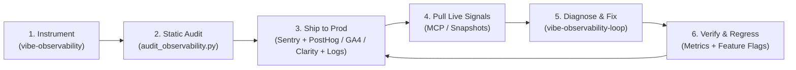

# vibe-observability

[](https://github.com/realchendahuang/vibe-observability/actions/workflows/ci.yml)
[](./LICENSE)

[English](./README.md) | [简体中文](./README_ZH.md)

**Production-grade Agent Skills for wiring full-stack observability & closing the AI self-optimization loop in Vibe Coding projects.**

Built for **Antigravity**, **Claude Code**, **Codex**, **Cursor**, and any agent supporting the open `SKILL.md` standard.

---

## Why This Exists

Vibe Coding lets you ship products in hours — and go completely blind the second they hit production.

A popular rule of thumb is: *"Have AI wire up Sentry, PostHog, GA4, and Microsoft Clarity, then feed your production data back into AI for a self-improving flywheel."*

The intuition is right, **but blindly asking an AI to install all four SDKs creates 5 real engineering traps**:

| Naive Vibe-Coding Trap | How `vibe-observability` Fixes It |
| :--- | :--- |
| **Dual Session-Replay Performance Tax** — Running PostHog Replay + Clarity + Sentry Replay simultaneously duplicates DOM MutationObservers and tanks Core Web Vitals. | **Mutually-Exclusive Profiles** (`core`, `marketing`, `full-deduped`, `ai-app`). Only one SDK owns session replay at a time. |
| **Frontend-Only Blind Spot** — Browser scripts never run when your API returns `502`, a Stripe webhook silently fails, or your SSL cert expires. | Pairs frontend telemetry with **structured JSON backend logs**, `X-Request-Id` correlation, `/api/health` probes, and external uptime checklist. |
| **Scattered Vendor Calls & Naming Drift** — `posthog.capture("clickBuy")` in one file and `gtag("event", "buy_btn")` in another ruins AI analysis. | Enforces one **typed `telemetry` facade**, `object_action` event taxonomy, and **Sentry ↔ PostHog cross-linking** (jump straight from crash to replay). |
| **AdBlockers, PII Leaks & Surprise Bills** — AdBlockers drop 30–50% of telemetry; GA4 bans PII; an accidental `useEffect` loop burns free quotas overnight. | First-party reverse proxy (`/ingest` + `/monitoring`), strict PII scrubbing & `maskAllInputs`, dev opt-out, client burst limiter, and bounded sampling. |
| **Unverified "Cargo-Cult" AI Optimizations** — Changing code on noisy data without checking whether metrics actually improved. | Companion **`vibe-observability-loop`** skill pairs Sentry/PostHog/Clarity signals with source-code diagnosis and mandatory post-deploy verification contracts. |

---

## The Closed Loop ("Left Foot Stepping on Right Foot")



---

## What's Inside

### Two Companion Skills

1. **`skills/vibe-observability`** — *Instrument & Guardrail*
   - Auto-detects framework (Next.js, Vite/React/Vue, Node, FastAPI, AI/LLM apps).
   - Selects the cleanest mutually-exclusive profile (`core`, `marketing`, `full-deduped`, or `ai-app`).
   - Builds a typed `telemetry` facade with Sentry ↔ PostHog session linking, reverse proxy (`/ingest`), privacy masking, dev opt-out, and backend structured logging + `/api/health`.
   - Runs the bundled zero-dependency static auditor (`scripts/audit_observability.py`) to verify zero critical/high pitfalls remain.

2. **`skills/vibe-observability-loop`** — *Diagnose, Fix & Verify*
   - Ingests live signals via MCP (Sentry MCP, PostHog MCP, etc.) or pasted user snapshots (error stacks, funnel exports, Clarity Rage Click / Dead Click reports).
   - Ranks issues by `Impact × Leverage × Confidence / Effort`.
   - Maps symptoms to exact source-code root causes, ships surgical fixes or Feature-Flagged experiments, and writes a concrete post-deploy verification & rollback contract.

### Built-in Zero-Dependency Static Auditor

Run `audit_observability.py` directly from your terminal, AI agent, or CI pipeline (Python 3.9+ stdlib only):

```bash
python3 skills/vibe-observability/scripts/audit_observability.py /path/to/your-app
# JSON output + CI gate on HIGH/CRITICAL issues:
python3 skills/vibe-observability/scripts/audit_observability.py /path/to/your-app --json --strict
```

Checks performed:
- `OBS-001` *(CRITICAL)*: Hardcoded Sentry Auth Tokens, Sentry DSNs, or PostHog project keys in source files
- `OBS-002` / `OBS-002B` *(HIGH)*: Dual session-replay conflicts (PostHog Replay + Clarity / Sentry Replay overlap)
- `OBS-003` *(HIGH)*: Unbounded `tracesSampleRate: 1.0` in production
- `OBS-004` *(HIGH)*: Potential PII forwarded to `gtag()` or Sentry `sendDefaultPii: true`
- `OBS-005` *(MEDIUM)*: PostHog Session Replay missing `maskAllInputs`
- `OBS-006` / `OBS-006B` *(MEDIUM/LOW)*: Missing first-party reverse proxy (`/ingest`) or Next.js Sentry `tunnelRoute`
- `OBS-007` *(MEDIUM)*: Raw vendor SDK calls scattered outside a telemetry facade
- `OBS-008` *(MEDIUM)*: Observability environment variables missing from `.env.example`
- `OBS-009` *(LOW)*: PostHog missing `person_profiles: 'identified_only'` cost guardrail
- `OBS-010` *(LOW)*: Backend detected without `/api/health` or structured JSON logging
- `OBS-011` *(INFO)*: Client SDK init missing dev-environment opt-out guard

---

## Observability Profiles

| Profile | Stack | Best For |
| :--- | :--- | :--- |
| **`core`** *(default)* | Sentry + PostHog + Backend Logs & `/health` | SaaS, indie web apps, full-stack MVPs |
| **`marketing`** | Sentry + GA4 + MS Clarity + `/health` | Landing pages, content/SEO sites, ad funnels |
| **`full-deduped`** | Sentry + PostHog *(replay OFF)* + GA4 + MS Clarity *(replay ON)* + Backend Logs | Growth-stage apps needing both deep product funnels/flags and Google Ads + free heatmaps |
| **`ai-app`** | `core` + LLM Generation Telemetry (`$ai_generation`, TTFT, tokens, cost, feedback) | AI wrappers, copilots, agents, RAG products |

---

## Installation

### Option 1: Clone & Run `install.sh` (Recommended)

```bash
git clone https://github.com/realchendahuang/vibe-observability.git
cd vibe-observability

# Antigravity (~/.gemini/config/skills)
./install.sh --target antigravity --symlink

# Claude Code (~/.claude/skills)
./install.sh --target claude --symlink

# Codex (~/.codex/skills)
./install.sh --target codex --symlink

# Cursor (~/.cursor/skills)
./install.sh --target cursor --symlink

# Shared ~/.agents/skills or all global agent roots at once
./install.sh --target agents --symlink
./install.sh --target all --symlink

# Project-local (.agents/skills inside a specific repo)
./install.sh --target project --project-dir /path/to/your-app --copy
```

### Option 2: Install via `skills` CLI

```bash
npx skills add realchendahuang/vibe-observability
```

---

## Usage Prompts

Once installed, trigger the skills naturally in your AI coding agent:

- **Full setup on a new project**:
  > *"Wire up production observability for this project using `vibe-observability` (pick the best profile for our stack and run the audit script when done)."*
- **Growth-max setup without replay conflicts**:
  > *"Set up Sentry, PostHog, GA4, and MS Clarity using the `full-deduped` profile with a typed telemetry facade and `/ingest` reverse proxy."*
- **Audit an existing codebase**:
  > *"Run a vibe-observability audit on this repo and fix any privacy, billing, or dual-replay issues."*
- **Close the AI optimization loop after launch**:
  > *"Use `vibe-observability-loop`: review our recent Sentry errors and PostHog funnel drop-offs, trace the top 3 root causes in the code, and propose fixes with a post-deploy verification plan."*

---

## Repository Layout

```text
vibe-observability/
├── install.sh                                  # Cross-agent installer (symlink / copy / uninstall)
├── skills/
│   ├── vibe-observability/                     # Skill 1: Instrumentation, Guardrails & Static Audit
│   │   ├── SKILL.md
│   │   ├── references/                         # Progressive-disclosure playbooks
│   │   │   ├── profiles.md
│   │   │   ├── telemetry-facade.md
│   │   │   ├── sentry.md
│   │   │   ├── posthog.md
│   │   │   ├── ga4-clarity.md
│   │   │   ├── backend-and-uptime.md
│   │   │   ├── privacy-and-cost.md
│   │   │   └── event-taxonomy.md
│   │   └── scripts/
│   │       └── audit_observability.py          # Zero-dependency static auditor
│   └── vibe-observability-loop/                # Skill 2: Production Data -> AI Fix -> Verify Loop
│       ├── SKILL.md
│       └── references/
│           ├── diagnosis-playbook.md
│           └── experiment-loop.md
├── templates/                                  # Copy-paste typed starter facades
│   ├── nextjs-app-router/
│   ├── vite-react/
│   └── backend-node-fastapi/
└── tests/                                      # Automated tests for auditor, skills & installer
```

---

## Development & Testing

```bash
python3 -m unittest discover -s tests -v
```

## License

[MIT](./LICENSE)
