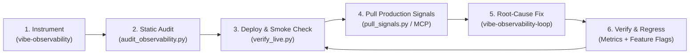

# vibe-observability

[](https://github.com/realchendahuang/vibe-observability/actions/workflows/ci.yml)
[](./LICENSE)

[English](./README.md) | [简体中文](./README_ZH.md)

**Framework-agnostic, production-grade Agent Skills for wiring full-stack observability, running pre/post-deploy audits, and closing the AI self-optimization loop.**

Works across **Web SPAs (Vite / React / TanStack / Hono / Oxc)**, **Cloudflare Edge (Workers / D1 / Queues / R2)**, **Self-Hosted High-Concurrency Backends (Go / Gin / Caddy / Pigsty / Prometheus / `pgmq` / OpenTelemetry)**, **Desktop & Native Apps (Electron / Wails v3 / Tauri 2 / Swift / Kotlin)**, **SSR Meta-Frameworks (Next.js / Nuxt / SvelteKit / Astro)**, and **Python + `uv` Automation Jobs**.

Compatible with **Antigravity**, **Claude Code**, **Codex**, **Cursor**, and any agent supporting the open `SKILL.md` standard.

---

## Why This Exists

Vibe Coding lets you ship products in hours — and go completely blind the second they hit production.

A popular meme says: *"Wire up Sentry, PostHog, GA4, and Microsoft Clarity, then feed production data back to AI for a self-improving flywheel."*

The intuition is right, **but blindly asking an AI to dump four web SDKs into every repo triggers real production failures**:

| Common Vibe-Coding Trap | How `vibe-observability` Solves It |
| :--- | :--- |
| **Dual Session-Replay Tax** — PostHog Replay + Clarity + Sentry Replay double DOM observers and wreck Core Web Vitals. | **7 Runtime-Matched Profiles** (`core`, `marketing`, `full-deduped`, `ai-app`, `selfhosted-infra`, `desktop-native`, `batch-jobs`). Only one replay engine runs at a time. |
| **Web Trackers in Desktop/Native or Edge** — Installing GA4/Clarity in Electron/Wails/Tauri breaks protocols & user trust; skipping `ctx.waitUntil()` on Cloudflare Workers drops 100% of server events. | **Progressive-disclosure stack adapters** tailored for Vite/TanStack/Hono/Oxc, Cloudflare Workers, Go/Gin/Caddy/Pigsty, Electron/Wails/Tauri/Swift/Kotlin, Python+`uv`, and SSR frameworks. |
| **Runtime Deployment Blind Spots** — Auth middleware 307-redirecting `/ingest` to `/login`, or `.js.map` leaking source code publicly. | Bundled **`verify_live.py`** live smoke-tester checks `/api/health`, `/ingest`, `/monitoring`, CSP headers, and public `.js.map` leaks right after deploy. |
| **AdBlockers, PII Leaks & Surprise Bills** — AdBlockers drop 30–50% of events; GA4 bans PII; an infinite `useEffect` loop blows quota overnight. | First-party reverse proxies (Hono/Workers, Caddy, framework rewrites), strict PII scrubbers, `oxlint` facade guardrails, burst limiters, and bounded sampling. |
| **Documentation-Only "AI Loops"** — Talking about AI optimization with no actual way to pull live data or prevent fake wins. | Companion **`vibe-observability-loop`** ships a read-only **`pull_signals.py`** CLI (Sentry + PostHog HogQL + local job JSONL) + MCP guide + mandatory post-deploy verification contracts. |

---

## The End-to-End Closed Loop



---

## Three Zero-Dependency CLI Tools Included (Python 3.9+ Stdlib)

### 1. Static Codebase Auditor (`audit_observability.py`)
Scans any repo (TypeScript/JS, Vue, Svelte, Go, Python, Rust, Swift, Kotlin, Wrangler, Caddyfile, Oxc) for 16 real pitfalls (`OBS-001`–`OBS-016`):

```bash
python3 skills/vibe-observability/scripts/audit_observability.py /path/to/repo
python3 skills/vibe-observability/scripts/audit_observability.py /path/to/repo --json --strict
```

Catches hardcoded keys/DSNs, dual replay conflicts, unbounded `tracesSampleRate: 1.0`, PII sent to GA4, missing `maskAllInputs` / `person_profiles` / `/ingest` proxy, scattered raw SDK calls, missing `.env.example` vars, web trackers in Electron/Wails/Tauri (`OBS-012`), unflushed Serverless/Workers PostHog (`OBS-013`), middleware blocking `/ingest` or `/monitoring` (`OBS-014`), undeleted source maps (`OBS-015`), and `@sentry/node` on Cloudflare Workers (`OBS-016`).

### 2. Post-Deploy Live Smoke Verifier (`verify_live.py`)
Catches deployment-time bugs static analysis cannot see:

```bash
python3 skills/vibe-observability/scripts/verify_live.py https://app.example.com --strict
```

Checks homepage reachability & HTTPS, `/api/health` or `/healthz` latency, `/ingest/static/array.js` (catches 302/307 auth redirects & HTML SPA fallbacks), `/monitoring` Sentry tunnel, **public `.js.map` source map leaks (`CRITICAL`)**, and CSP compatibility.

### 3. Read-Only Signal Puller (`pull_signals.py`)
Pulls a compact AI-ready brief without heavy MCP setup (strictly read-only, never prints tokens):

```bash
python3 skills/vibe-observability-loop/scripts/pull_signals.py --days 7
python3 skills/vibe-observability-loop/scripts/pull_signals.py --days 7 --job-history ./logs/runs.jsonl
```

Fetches Sentry top unresolved issues by affected users, PostHog top events & `$ai_generation` LLM latency/token summaries via HogQL, and local Python scraper/job JSONL anomaly summaries.

---

## Observability Profiles

| Profile | Stack | Best For |
| :--- | :--- | :--- |
| **`core`** *(default Web)* | Sentry + PostHog + Structured Logs & `/health` | Vite/React/TanStack/Hono, Next.js/Nuxt, SaaS MVPs |
| **`marketing`** | Sentry + GA4 + MS Clarity + `/health` | Landing pages, SEO/content sites, Google Ads funnels |
| **`full-deduped`** | Sentry + PostHog *(replay OFF)* + GA4 + MS Clarity *(replay ON)* + Logs | Growth products needing both product funnels/flags and Ads + free heatmaps |
| **`ai-app`** | `core` + LLM Generation Telemetry (`$ai_generation`, TTFT, tokens, cost, feedback) | AI copilots, agents, RAG apps |
| **`selfhosted-infra`** | Go `log/slog` + Sentry + `/metrics` (Pigsty/Prometheus/Loki) + Caddy `/ingest` + `pgmq` alerts | Dedicated servers, Go + Gin + Docker + Caddy + Pigsty (`pgmq`/Valkey/RustFS) |
| **`desktop-native`** | Native Sentry (`@sentry/electron`, `sentry-go`, `sentry` Rust, `sentry-cocoa`/`MetricKit`, `sentry-android`) + Rotating local logs + Opt-out events | Electron, Wails v3, Tauri 2, Swift (macOS/iOS), Kotlin (Android) — **NO GA4/Clarity** |
| **`batch-jobs`** | `structlog` JSON + Sentry Crons + Run Summary & silent volume-drop alerts | Python + `uv` scrapers, Ego Lite automation, ETL/cron workers |

---

## Installation

Each skill directory under `skills/` is **100% self-contained** (references, examples, and zero-dependency scripts all bundled inside).

### Option 1: Clone & Run `install.sh` (Recommended)

```bash
git clone https://github.com/realchendahuang/vibe-observability.git
cd vibe-observability

# Antigravity (~/.gemini/config/skills)
./install.sh --target antigravity --symlink

# Claude Code / Codex / Cursor / Shared ~/.agents / All
./install.sh --target claude --symlink
./install.sh --target codex --symlink
./install.sh --target cursor --symlink
./install.sh --target all --symlink

# Project-local (.agents/skills inside one repo)
./install.sh --target project --project-dir /path/to/your-app --copy
```

### Option 2: Install via `skills` CLI

```bash
npx skills add realchendahuang/vibe-observability
```

---

## Repository Layout

```text
vibe-observability/
├── install.sh                                      # Cross-agent installer (symlink / copy / uninstall)
├── skills/
│   ├── vibe-observability/                         # Self-contained Skill 1: Instrument, Audit & Smoke-Verify
│   │   ├── SKILL.md
│   │   ├── references/
│   │   │   ├── profiles.md
│   │   │   ├── telemetry-facade.md
│   │   │   ├── sentry.md / posthog.md / ga4-clarity.md
│   │   │   ├── backend-and-uptime.md / privacy-and-cost.md / event-taxonomy.md
│   │   │   ├── stack-web-vite-tanstack.md          # Vite 8, TanStack, Hono, Better Auth, Oxc, Web Vitals
│   │   │   ├── stack-cloudflare-edge.md            # Workers, Hono, ctx.waitUntil, D1, KV, Queues DLQ, R2
│   │   │   ├── stack-go-selfhosted.md              # Go, Gin, log/slog, Caddy, Pigsty, pgmq, Valkey, OTel
│   │   │   ├── stack-desktop-native.md             # Electron, Wails v3, Tauri 2, Swift, Kotlin
│   │   │   ├── stack-python-jobs.md                # Python + uv, Ego Lite scrapers, Sentry Crons
│   │   │   └── stack-ssr-metaframeworks.md         # Next.js, Nuxt, SvelteKit, Astro
│   │   ├── examples/                               # Self-contained drop-in starters
│   │   │   ├── vite-tanstack-hono/
│   │   │   ├── cloudflare-workers-hono/
│   │   │   ├── go-gin-caddy/
│   │   │   ├── python-uv-job/
│   │   │   └── nextjs-app-router/
│   │   └── scripts/
│   │       ├── audit_observability.py              # Static codebase auditor (OBS-001..016)
│   │       └── verify_live.py                      # Post-deploy live smoke verifier (LIVE-001..006)
│   └── vibe-observability-loop/                    # Self-contained Skill 2: Pull -> Diagnose -> Fix -> Verify
│       ├── SKILL.md
│       ├── references/
│       │   ├── mcp-and-apis.md
│       │   ├── diagnosis-playbook.md
│       │   └── experiment-loop.md
│       └── scripts/
│           └── pull_signals.py                     # Read-only Sentry + PostHog + job-history puller
└── tests/                                          # Automated unit + mock-HTTP + sandbox-install tests
```

## Development & Testing

```bash
python3 -m unittest discover -s tests -v
```

## License

[MIT](./LICENSE)
