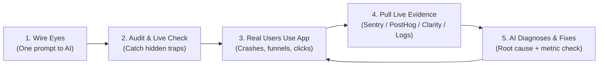

# vibe-observability

[](https://github.com/realchendahuang/vibe-observability/actions/workflows/ci.yml)
[](https://github.com/realchendahuang/vibe-observability/releases)
[](./LICENSE)

[English](./README.md) | [简体中文](./README_ZH.md)

**Give your AI coding agent eyes in production.**

---

## 1. Why You Need Production Monitoring (The Blindfold Problem)

AI coding agents (Antigravity, Claude Code, Codex, Cursor) let you build and ship a real product in a single weekend.

**The moment it goes live, both you and your AI go completely blind.**

Picture what actually happens on launch day: you post your app, 500 real visitors arrive, 3 people sign up, and **0 people pay**. Naturally, you assume *"maybe nobody wants my idea."*

In reality, **99% of users who hit a bug will never email you — they just close the tab forever.** Half the time, your idea isn't broken; your production app is:

* **Safari / mobile users hit a blank white screen** (it worked on your laptop's Chrome, so you had no idea).
* **A popup or sticky bar covered the "Pay Now" button on small screens**, and users rage-clicked it five times before leaving.
* **90% of users dropped off on Step 2 of onboarding**, while you spent all week tweaking the landing page headline.
* **Your payment webhook or server silently returned `500` at 3 AM** — users paid, never got upgraded, and disputed the charge.

That is the real value of **production observability**:
1. **Stop guessing after launch** — know *what broke*, *who it affected*, and *exactly where users get stuck*.
2. **Unlock AI self-improvement** — once live errors and user friction are captured cleanly, your AI coding agent can **read that real production evidence itself**, trace it straight to the exact line of source code, and write fixes for what actually hurts users.

---

## 2. Plain-English Glossary (All the Jargon, Explained Like Running a Shop)

If terms like *observability*, *Sentry*, *PostHog*, or *Source Maps* feel intimidating, think of your deployed app like a physical retail store:

| Term | Plain English (Shop Analogy) | What Question Does It Answer? |
| :--- | :--- | :--- |
| **Observability** | Installing security cameras, alarms, and a cash-register ledger in your shop | What is *actually* happening inside my live app right now? |
| **Sentry** | The **fire & breakage alarm** | Did my app crash for a user? On which browser/device, and on which exact line of code? |
| **PostHog** | The **foot-traffic & checkout counter** | Out of 100 visitors, how many signed up, activated, and paid? Where do most people drop off? (Also includes session replay & A/B flags.) |
| **GA4** *(Google Analytics)* | The **front-door greeter log** | Where did visitors come from — Google Search, X, Reddit, or paid ads? |
| **Microsoft Clarity** | Free **heatmaps & CCTV replay** | Where do users click and scroll? Are they **Rage Clicking** (frantically clicking a broken/slow button) or **Dead Clicking** (clicking something that looks clickable but does nothing)? |
| **Source Maps (`.js.map`)** | The **decoder ring** for minified code | Bundlers compress your JS into unreadable gibberish. Uploading source maps to Sentry shows real file/line numbers — **but leaving `.js.map` public lets anyone download your source code**. |
| **Reverse Proxy (`/ingest`)** | A **first-party mailroom** on your own domain | 30–50% of tech users run AdBlockers that block requests to `posthog.com` or `sentry.io`. Routing through your own domain (e.g. `yoursite.com/ingest`) keeps telemetry working reliably. |
| **Health Probe (`/api/health`) & Structured Logs** | The **kitchen heartbeat & shift log** | When your server crashes with `502` or your SSL cert expires, browser scripts never even load. Server JSON logs and external uptime pings catch outages browser trackers miss. |
| **PII Masking** | **Auto-blurring** sensitive faces/screens on CCTV | Automatically hides passwords, emails, and tokens in replays and error reports so you protect user privacy (and don't get banned by GA4 for sending emails). |

---

## 3. Why Not Just Ask AI: *"Add Sentry, PostHog, GA4, and Clarity"*?

Because when you ask an AI to wire up monitoring from scratch with no guardrails, it falls into the same **5 expensive traps** over and over:

1. **Slowing your site to a crawl**: Installing PostHog Replay + Clarity + Sentry Replay at the same time attaches multiple heavy DOM recorders to every page.
2. **Collecting zero real data**: Forgetting a reverse proxy (AdBlockers drop half your users), or adding `/ingest` while auth middleware redirects it (`307 -> /login`), or polluting live funnels with your own `localhost` testing.
3. **Waking up to a surprise bill**: Hardcoding `tracesSampleRate: 1.0` (100% tracing), or shipping an accidental React `useEffect` loop that burns your monthly free quota overnight.
4. **Leaking user privacy or source code**: Recording password/billing inputs unmasked, sending raw emails to GA4, or forgetting to delete `.js.map` files after uploading to Sentry.
5. **Using web tools where they break**: Putting GA4/Clarity inside Electron, Wails, or Tauri desktop apps (breaks protocols and destroys user trust), forgetting `ctx.waitUntil()` in Cloudflare Workers (drops 100% of server events), or missing silent zero-row failures in Python scrapers.

---

## 4. How `vibe-observability` Fixes This (3-Step Closed Loop)

`vibe-observability` packages battle-tested engineering guardrails as **Agent Skills** (for Antigravity, Claude Code, Codex, Cursor) plus **3 zero-dependency verification tools** so your AI doesn't just guess — it verifies its own work.



### Step 1 · Before Launch: Give Your AI Eyes (5 Minutes)
Tell your coding agent:
> *"Use `vibe-observability` to set up production monitoring for this project."*

Your agent inspects your repo, picks the lightest non-overlapping combo for your runtime (web app, marketing site, Cloudflare Worker, Go server, desktop app, or Python job), builds one clean typed `telemetry` wrapper, adds privacy/cost/proxy guardrails, and runs **`vibe-obs audit`** to prove zero critical/high traps remain.

### Step 2 · Right After Deploy: Check Its Eyesight (3 Seconds)
Run one live smoke check against your production URL:
```bash
vibe-obs verify https://your-app.com --strict
```
It makes real HTTP requests to confirm `/api/health` is fast, `/ingest` isn't silently redirected to `/login`, and your `.js.map` source code isn't exposed publicly.

### Step 3 · One Week Later: Let AI Diagnose & Fix Real User Pain
Tell your coding agent:
> *"Use `vibe-observability-loop`: pull the last 7 days of production issues, find the top 3 root causes hurting users, and fix them with a verification plan."*

Your agent pulls real crashes, funnel drop-offs, and rage clicks (via MCP or the bundled read-only `vibe-obs pull`), links crashes straight to the exact code files, writes surgical fixes, and defines the metric to verify after deploy.

---

## 5. Get Started in 10 Seconds

### A. Install the Agent Skills (Recommended)

Works out of the box with **Antigravity**, **Claude Code**, **Codex**, and **Cursor**:

```bash
# Quickest universal install
npx skills add realchendahuang/vibe-observability
```

Or clone and install via `install.sh`:

```bash
git clone https://github.com/realchendahuang/vibe-observability.git
cd vibe-observability

./install.sh --target antigravity --symlink   # ~/.gemini/config/skills
./install.sh --target claude --symlink        # ~/.claude/skills
./install.sh --target codex --symlink         # ~/.codex/skills
./install.sh --target cursor --symlink        # ~/.cursor/skills
./install.sh --target all --symlink           # All global agent roots
```

### B. Just Want to Test Your Existing Project First? (Zero Install via `uvx`)

Try the bundled tools on any local repo or live website in 3 seconds — zero dependencies, strictly local/read-only:

```bash
# Check your codebase for 16 common monitoring pitfalls
uvx --from git+https://github.com/realchendahuang/vibe-observability vibe-obs audit .

# Smoke-test your deployed URL (health probe, /ingest redirects, leaked .js.map)
uvx --from git+https://github.com/realchendahuang/vibe-observability vibe-obs verify https://your-app.com

# Pull a read-only production summary (Sentry / PostHog / Clarity / Prometheus / Jobs)
uvx --from git+https://github.com/realchendahuang/vibe-observability vibe-obs pull --days 7
```

<details>
<summary><strong>See sample terminal output (audit &amp; live verify)</strong></summary>

```text
$ vibe-obs audit ./my-web-app --strict
Vibe Observability Audit — /workspace/my-web-app
====================================================================
Files scanned : 48
Providers     : sentry, posthog, ga4, clarity
Score         : 10/100  (CRITICAL=0 HIGH=3 MEDIUM=3 LOW=1 INFO=0)

[HIGH] OBS-002: Dual session-replay conflict: PostHog Replay + Microsoft Clarity both active
  Fix : Set `disable_session_recording: true` in `posthog.init(...)`, or drop Clarity.
[HIGH] OBS-003: Unbounded Sentry tracing sample rate (100%)
  Fix : Use an environment-aware sample rate such as `0.1` in production and `0` in dev.
[HIGH] OBS-004: Potential PII forwarded to GA4 or Sentry default PII capture enabled
  Fix : Set `sendDefaultPii: false` in Sentry and never pass email/phone/name into `gtag()`.

$ vibe-obs verify https://app.example.com --strict
[PASS]     LIVE-001: Homepage healthy (HTTP 200) (118ms)
[PASS]     LIVE-002: Health probe healthy (HTTP 200 in 24ms)
[HIGH]     LIVE-003: PostHog proxy redirected (HTTP 307 -> /login)
[CRITICAL] LIVE-005: Public source maps exposed (1 file(s)) -> /assets/app.js.map
```

</details>

---

## 6. Under the Hood (For Engineers & Full-Stack Teams)

Every detail below is progressively loaded by your AI **only when your project matches that stack**, keeping everyday context clean.

<details>
<summary><strong>Supported Stacks &amp; 7 Mutually-Exclusive Profiles (Web, Edge, Go/Pigsty, Desktop/Native, Python Jobs)</strong></summary>

| Profile | Stack | Best For |
| :--- | :--- | :--- |
| **`core`** *(default Web)* | Sentry + PostHog + Structured Logs & `/health` | Vite/React/TanStack/Hono, Next.js/Nuxt/Astro, SaaS MVPs |
| **`marketing`** | Sentry + GA4 + MS Clarity + `/health` | Landing pages, SEO/content sites, Google Ads funnels |
| **`full-deduped`** | Sentry + PostHog *(replay OFF)* + GA4 + MS Clarity *(replay ON)* + Logs | Growth products needing both product funnels/flags and Ads + free heatmaps |
| **`ai-app`** | `core` + LLM Telemetry (`$ai_generation`, TTFT, tokens, cost, user feedback) | AI copilots, agents, RAG apps |
| **`selfhosted-infra`** | Go `log/slog` + Sentry + `/metrics` (Pigsty/Prometheus/Loki) + Caddy `/ingest` + `pgmq` alerts | Dedicated servers, Go + Gin + Docker + Caddy + Pigsty (`pgmq`/Valkey/RustFS) + OpenTelemetry path |
| **`desktop-native`** | Native Sentry (`@sentry/electron`, `sentry-go`, `sentry` Rust, `sentry-cocoa`/`MetricKit`, `sentry-android`) + Rotating local logs + Opt-out events | Electron, Wails v3, Tauri 2, Swift (macOS/iOS), Kotlin (Android) — **NO GA4/Clarity** |
| **`batch-jobs`** | `structlog` JSON + Sentry Crons + Run Summary & silent volume-drop alerts | Python + `uv` scrapers, Ego Lite automation, ETL/cron workers |

Dedicated stack adapters & audited drop-in examples live inside [`skills/vibe-observability/`](./skills/vibe-observability/) (100% self-contained):
- Vite 8 + React + TanStack (Router/Query/Start) + Hono + Better Auth + Oxc (`oxlint` facade enforcement) + Web Vitals
- Cloudflare Workers + Hono + `@sentry/cloudflare` + `ctx.waitUntil` + D1/KV/Queues DLQ/R2
- Go + Gin + `log/slog` + Caddy reverse proxy + Pigsty + `pgmq` + OpenTelemetry escape hatch
- Electron, Go + Wails v3 + SQLite, Rust Tauri 2, Swift (`OSLog`/MetricKit), Kotlin
- Python + `uv` scrapers & automation jobs
- Next.js, Nuxt, SvelteKit, Astro

</details>

<details>
<summary><strong>Reproducible Benchmark (Naive AI Setup vs <code>vibe-observability</code>)</strong></summary>

Run `python3 evals/run_benchmark.py` locally to reproduce:

| Category | Scenario | Audit Score | Critical/High | Triggered Rules |
| :--- | :--- | :---: | :---: | :--- |
| Before (Naive) | Naive Web App (unbounded 4-SDK dump) | **0/100** | 3 | OBS-002, OBS-003, OBS-004, OBS-005, OBS-006, OBS-007, OBS-008, OBS-009, OBS-011 |
| Before (Naive) | Naive Cloudflare Worker (Node SDK + no `waitUntil`) | **25/100** | 3 | OBS-003, OBS-013, OBS-016, OBS-008, OBS-010, OBS-011 |
| Before (Naive) | Naive Desktop Tauri App (web Clarity + GA4) | **50/100** | 2 | OBS-004, OBS-012, OBS-008, OBS-011 |
| After (`vibe-observability`) | Starter: `vite-tanstack-hono` | **100/100** | 0 | None (PASS) |
| After (`vibe-observability`) | Starter: `cloudflare-workers-hono` | **100/100** | 0 | None (PASS) |
| After (`vibe-observability`) | Starter: `go-gin-caddy` | **100/100** | 0 | None (PASS) |
| After (`vibe-observability`) | Starter: `python-uv-job` | **100/100** | 0 | None (PASS) |
| After (`vibe-observability`) | Starter: `nextjs-app-router` | **100/100** | 0 | None (PASS) |

</details>

<details>
<summary><strong>CI Configuration, Rule Suppression (<code>.vibe-observability.json</code>) &amp; Repository Layout</strong></summary>

Suppress intentional exceptions in CI via `--ignore OBS-006B,OBS-010` or a project-root `.vibe-observability.json`:

```json
{
  "ignore": ["OBS-006B", "OBS-010"],
  "exclude_paths": ["legacy/", "scripts/scratch/"]
}
```

Repository layout:

```text
vibe-observability/
├── pyproject.toml                        # Zero-dependency `vibe-obs` CLI (uvx-ready)
├── src/vibe_observability/cli.py         # Unified CLI dispatcher (audit / verify / pull)
├── install.sh                            # Cross-agent skill installer
├── skills/
│   ├── vibe-observability/               # Skill 1: Wire Eyes + Guardrails + Audit + Verify
│   │   ├── SKILL.md
│   │   ├── references/                   # Core guardrails + 6 stack adapters
│   │   ├── examples/                     # 5 self-contained 100/100 starter stacks
│   │   └── scripts/                      # audit_observability.py & verify_live.py
│   └── vibe-observability-loop/          # Skill 2: Pull Live Evidence -> Fix -> Verify
│       ├── SKILL.md
│       ├── references/                   # MCP/API guide, Diagnosis Playbook, Verification Loop
│       └── scripts/                      # pull_signals.py (Sentry/PostHog/Clarity/Prometheus/Jobs)
├── evals/                                # Reproducible Before-vs-After benchmark
└── tests/                                # 16 strict zero-warning tests
```

</details>

---

## Contributing, Security & License

* Run tests locally: `python3 -W error -m unittest discover -s tests -v`
* Docs: [CONTRIBUTING.md](./CONTRIBUTING.md) · [SECURITY.md](./SECURITY.md) · [CHANGELOG.md](./CHANGELOG.md)
* License: [MIT](./LICENSE)
