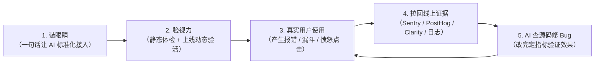

# vibe-observability

[](https://github.com/realchendahuang/vibe-observability/actions/workflows/ci.yml)
[](https://github.com/realchendahuang/vibe-observability/releases)
[](./LICENSE)

[English](./README.md) | [简体中文](./README_ZH.md)

**给你的 AI 编程助手装上线上眼睛。**

---

## 一、为什么要装生产环境监控？（故事的起点）

现在用 AI（Antigravity、Claude Code、Codex、Cursor）写产品，一个周末就能上线。

**但产品一上线，你和你的 AI 就一起“瞎”了。**

想象一下最真实的上线惨案：你辛苦发帖推广，来了 500 个真实访客，结果只有 3 个人注册、**0 个人付费**。你心里开始打鼓：*“是不是我这个点子根本没人要？”*

可真相往往很残酷：**99% 遇到 Bug 的用户根本不会给你发反馈，他们只会默默关掉页面、再也不来。** 很多时候不是产品没人要，而是你的线上环境出了你完全看不见的故障：

* **用户的 Safari 或手机微信打开直接白屏报错**（你自己电脑用 Chrome，完全复现不了）；
* **手机小屏上弹窗把“立即支付”按钮挡住了**，用户狂点 5 下没反应，气得直接退出；
* **90% 的人在注册第 2 步就卡住流失了**，你却花了一整周在疯狂改首页标题；
* **凌晨 3 点服务器 500 或支付回调静默失败**，用户扣了钱却没开通会员。

这就是**生产环境监控**真正不可替代的两大价值：
1. **上线不再靠猜**：清楚看到“哪里崩了、影响了多少人、用户在哪一步卡住了”。
2. **让 AI 从“瞎猜改代码”进化成“看真实证据自动修 Bug”**：当线上的报错、流失和卡点都结构化采集下来后，你的 AI 编程助手就能**亲自读取线上真实数据**，直接定位到出问题的源码行把 Bug 修掉，实现越用越好的自进化闭环。

---

## 二、30 秒看懂所有名词（像开一家实体店一样理解）

如果你看到“可观测性”“Sentry”“PostHog”“Source Map”“反向代理”这些词就头大，把它想象成**你开了一家线下实体店**，30 秒全部秒懂：

| 技术名词 | 说人话是什么？（实体店比喻） | 它帮你回答什么问题？ |
| :--- | :--- | :--- |
| **可观测性（Observability）** | 给店里装全套**监控摄像头 + 警报器 + 经营账本** | 产品上线后，内部健不健康、用户到底怎么用的？ |
| **Sentry（错误监控）** | 店里的**故障报警器** | 哪个用户在什么浏览器/手机上白屏崩溃了？精确崩在源码第几行？ |
| **PostHog（产品分析）** | 店里的**客流转化与回放系统** | 进来 100 个人，多少人注册、多少人付费、哪一步流失最多？（还自带录屏和 A/B 实验） |
| **GA4** *(Google Analytics)* | 门口的**迎宾登记簿** | 用户是从 Google 搜索、X、小红书还是广告点进来的？ |
| **Microsoft Clarity** | 免费的**点击热力图 + 监控录像** | 用户最爱点哪？有没有对着某个坏按钮狂点（**愤怒点击 / Rage Click**）或误点假按钮（**死点击 / Dead Click**）？ |
| **Source Map（`.js.map`）** | 报错堆栈的**翻译密码本** | 前端代码上线会被压缩成乱码，传给 Sentry 才能还原真实报错行号；**但如果误留在公网，任何人都能直接扒走你的源码**。 |
| **反向代理（`/ingest`）** | 挂在自家域名下的**收发室** | 30%–50% 科技用户装了广告拦截器（AdBlock），直连 `posthog.com` 会被拦掉；走自家域名转发就能稳稳收数。 |
| **健康探针（`/api/health`）与结构化日志** | 后厨的**心跳脉搏 + 规范流水账** | 服务器直接 502 宕机或 SSL 证书过期时，网页脚本根本跑不起来；靠后台 JSON 日志和外部定时心跳才能第一时间告警。 |
| **PII 脱敏（隐私保护）** | 录像时的**自动打码机** | 录屏和报错时自动遮掉密码、邮箱、Token，保护用户隐私，也避免因为给 GA4 传邮箱被封号。 |

---

## 三、那我直接跟 AI 说“帮我接 Sentry 和 PostHog”不行吗？

这就是几乎所有 Vibe Coder 都踩过的坑——**直接裸问 AI 接监控，它会反复翻 5 个车**：

1. **把网页拖卡死**：AI 把 PostHog 录屏、Clarity 录屏、Sentry 录屏一股脑全装上，浏览器同时跑多套页面监听，首屏变慢、掉帧。
2. **装完等于白装（线上 0 数据）**：没配反向代理被 AdBlock 拦掉一半用户；或者配了 `/ingest` 却忘了在登录中间件里放行，结果全被 `307` 踢去 `/login`；或者把你自己 `localhost` 测试的脏数据全混进了线上报表。
3. **一觉醒来收高额账单**：AI 随手写了个 `tracesSampleRate: 1.0`（100% 采样），或者写了个 React `useEffect` 死循环，一个晚上把免费额度打爆扣费。
4. **隐私和源码裸奔**：录屏忘遮密码输入框、往 GA4 传用户邮箱（违反协议会被封号）、或者构建完忘删 `.js.map` 把源码直接暴露在公网。
5. **非网页项目瞎套网页方案**：给桌面软件（Electron / Wails / Tauri）硬塞 GA4/Clarity（协议报错还会被当间谍软件差评）；在 Cloudflare Workers 里忘写 `ctx.waitUntil()` 导致服务端事件丢光；Python 抓取脚本 0 报错但抓回 0 条数据却没人知道。

---

## 四、`vibe-observability` 怎么解决？（给 AI 装眼睛的 3 步闭环）

`vibe-observability` 把老司机踩过的坑焊成了 **Agent Skills**（兼容 Antigravity、Claude Code、Codex、Cursor），并自带 **3 个零依赖自动校验工具**——不只教 AI 怎么写，还用程序客观验收它写得对不对。



### 第 1 步 · 上线前，5 分钟给项目装上眼睛
对你的 AI 编程助手说一句：
> *“帮我用 `vibe-observability` 给这个项目装上生产监控。”*

AI 会自动看懂你的项目形态（网站、营销页、Cloudflare Workers、Go 后端、桌面端还是 Python 抓取脚本），挑出最轻且不打架的组合，建好统一的埋点封装、反向代理、隐私脱敏和防爆费限制，最后自动跑一遍 **`vibe-obs audit`** 确认零高危隐患。

### 第 2 步 · 上线后，3 秒钟验视力
发完线上跑一条命令：
```bash
vibe-obs verify https://你的域名 --strict
```
它会真发 HTTP 请求验证：健康心跳是否正常、`/ingest` 反代有没有被登录页拦死、`.js.map` 源码有没有公网泄露。

### 第 3 步 · 跑了一周后，让 AI 自己看病开药
对你的 AI 说一句：
> *“用 `vibe-observability-loop` 拉一下最近 7 天的线上数据，找出最影响用户的 3 个问题并修掉。”*

AI 通过 MCP 或内置只读命令 `vibe-obs pull` 把真实报错、流失漏斗、愤怒点击（或服务器指标/脚本异常）拉回编辑器，直接定位到具体源码行写修复代码，并定好上线后的验证指标——**左脚踩右脚，越用越好**。

---

## 五、10 秒钟上手

### A. 安装 Agent Skills（推荐）

开箱支持 **Antigravity**、**Claude Code**、**Codex**、**Cursor**：

```bash
# 最快通用安装方式
npx skills add realchendahuang/vibe-observability
```

或克隆仓库后使用 `install.sh`：

```bash
git clone https://github.com/realchendahuang/vibe-observability.git
cd vibe-observability

./install.sh --target antigravity --symlink   # ~/.gemini/config/skills
./install.sh --target claude --symlink        # ~/.claude/skills
./install.sh --target codex --symlink         # ~/.codex/skills
./install.sh --target cursor --symlink        # ~/.cursor/skills
./install.sh --target all --symlink           # 一次性安装到所有全局目录
```

### B. 还不想装 Skill？先用 `uvx` 3 秒免费体检你的项目

零第三方依赖、纯本地/只读运行，不用 clone 直接体验：

```bash
# 体检你手头的本地仓库（自动揪出 16 条高发监控坑）
uvx --from git+https://github.com/realchendahuang/vibe-observability vibe-obs audit .

# 验活你的线上网址（查健康探针、/ingest 被拦截、.js.map 源码泄露）
uvx --from git+https://github.com/realchendahuang/vibe-observability vibe-obs verify https://你的域名

# 一键只读拉取线上信号简报（Sentry / PostHog / Clarity / Prometheus / 抓取作业）
uvx --from git+https://github.com/realchendahuang/vibe-observability vibe-obs pull --days 7
```

<details>
<summary><strong>点击查看真实终端输出样例（audit &amp; verify）</strong></summary>

```text
$ vibe-obs audit ./my-web-app --strict
Vibe Observability Audit — /workspace/my-web-app
====================================================================
Files scanned : 48
Providers     : sentry, posthog, ga4, clarity
Score         : 10/100  (CRITICAL=0 HIGH=3 MEDIUM=3 LOW=1 INFO=0)

[HIGH] OBS-002: Dual session-replay conflict: PostHog Replay + Microsoft Clarity both active
  Fix : Set `disable_session_recording: true` in `posthog.init(...)`, or drop Clarity.
[HIGH] OBS-003: Unbounded Sentry tracing sample rate (100%)
  Fix : Use an environment-aware sample rate such as `0.1` in production and `0` in dev.
[HIGH] OBS-004: Potential PII forwarded to GA4 or Sentry default PII capture enabled
  Fix : Set `sendDefaultPii: false` in Sentry and never pass email/phone/name into `gtag()`.

$ vibe-obs verify https://app.example.com --strict
[PASS]     LIVE-001: Homepage healthy (HTTP 200) (118ms)
[PASS]     LIVE-002: Health probe healthy (HTTP 200 in 24ms)
[HIGH]     LIVE-003: PostHog proxy redirected (HTTP 307 -> /login)
[CRITICAL] LIVE-005: Public source maps exposed (1 file(s)) -> /assets/app.js.map
```

</details>

---

## 六、硬核工程细节（按需展开）

以下内容采用**渐进式按需加载**——你的 AI 只有在识别到对应技术栈时才会读取，平时完全不浪费上下文。

<details>
<summary><strong>支持的全技术栈 &amp; 7 档互斥套餐矩阵（Web / Cloudflare / Go+Pigsty / 桌面与原生 / Python 脚本）</strong></summary>

| 套餐 | 核心组合 | 适用场景 |
| :--- | :--- | :--- |
| **`core`** *（默认 Web）* | Sentry + PostHog + 结构化日志 & `/health` | Vite/React/TanStack/Hono、Next.js/Nuxt/Astro、SaaS MVP |
| **`marketing`** | Sentry + GA4 + MS Clarity + `/health` | 落地页、SEO 内容站、Google 广告投流 |
| **`full-deduped`** | Sentry + PostHog *（关录屏）* + GA4 + MS Clarity *（开录屏）* + 日志 | 既要产品漏斗/Feature Flag 又要广告归因与免费热力图 |
| **`ai-app`** | `core` + LLM 遥测（`$ai_generation`、TTFT、Token、成本、反馈） | AI 工具、Copilot、Agent、RAG 产品 |
| **`selfhosted-infra`** | Go `log/slog` + Sentry + `/metrics`（并入 Pigsty Prometheus/Grafana/Loki）+ Caddy `/ingest` + `pgmq` 堆积告警 | 独立服务器、Go + Gin + Docker + Caddy + Pigsty（`pgmq`/Valkey/RustFS）+ OpenTelemetry 逃生舱 |
| **`desktop-native`** | 原生崩溃上报（`@sentry/electron` / `sentry-go` / `sentry` Rust / `sentry-cocoa`+`MetricKit` / `sentry-android`）+ 本地滚动日志 + 可关闭匿名事件 | Electron、Wails v3、Tauri 2、Swift（macOS/iOS）、Kotlin（Android）— **严禁 GA4/Clarity** |
| **`batch-jobs`** | `structlog` JSON + Sentry Crons 死人开关 + Run Summary 与抓取量骤降告警 | Python + `uv` 抓取脚本、Ego Lite 自动化、定时 ETL |

完整适配器与 5 套通过 100/100 审计的开箱样板均内置于 [`skills/vibe-observability/`](./skills/vibe-observability/)（100% 自包含）：
- Vite 8 + React + TanStack（Router/Query/Start）+ Hono + Better Auth + Oxc（`oxlint` 封装规则）+ Web Vitals
- Cloudflare Workers + Hono + `@sentry/cloudflare` + `ctx.waitUntil` + D1/KV/Queues DLQ/R2
- Go + Gin + `log/slog` + Caddy 反代 + Pigsty + `pgmq` + OpenTelemetry 演进路线
- Electron、Go + Wails v3 + SQLite、Rust Tauri 2、Swift（`OSLog`/MetricKit）、Kotlin
- Python + `uv` 抓取与自动化脚本
- Next.js、Nuxt、SvelteKit、Astro

</details>

<details>
<summary><strong>可复现前后对比基准（无脑 AI 接入 vs <code>vibe-observability</code>）</strong></summary>

本地运行 `python3 evals/run_benchmark.py` 即可 100% 复现：

| 类别 | 场景 | 审计得分 | Critical/High | 触发规则 |
| :--- | :--- | :---: | :---: | :--- |
| 优化前（Naive） | 无脑全装 4 家 SDK 的 Web 应用 | **0/100** | 3 | OBS-002, OBS-003, OBS-004, OBS-005, OBS-006, OBS-007, OBS-008, OBS-009, OBS-011 |
| 优化前（Naive） | 误用 `@sentry/node` 且漏 `waitUntil` 的 Workers | **25/100** | 3 | OBS-003, OBS-013, OBS-016, OBS-008, OBS-010, OBS-011 |
| 优化前（Naive） | 误装 Web Clarity + GA4 的桌面 Tauri 应用 | **50/100** | 2 | OBS-004, OBS-012, OBS-008, OBS-011 |
| 优化后（`vibe-observability`） | 样板：`vite-tanstack-hono` | **100/100** | 0 | None (PASS) |
| 优化后（`vibe-observability`） | 样板：`cloudflare-workers-hono` | **100/100** | 0 | None (PASS) |
| 优化后（`vibe-observability`） | 样板：`go-gin-caddy` | **100/100** | 0 | None (PASS) |
| 优化后（`vibe-observability`） | 样板：`python-uv-job` | **100/100** | 0 | None (PASS) |
| 优化后（`vibe-observability`） | 样板：`nextjs-app-router` | **100/100** | 0 | None (PASS) |

</details>

<details>
<summary><strong>CI 白名单配置（<code>.vibe-observability.json</code>）与仓库目录结构</strong></summary>

放进真实项目 CI 时，可通过 `--ignore OBS-006B,OBS-010` 或根目录 `.vibe-observability.json` 忽略合理的业务例外：

```json
{
  "ignore": ["OBS-006B", "OBS-010"],
  "exclude_paths": ["legacy/", "scripts/scratch/"]
}
```

仓库目录结构：

```text
vibe-observability/
├── pyproject.toml                        # 零依赖 `vibe-obs` CLI 打包配置（支持 uvx）
├── src/vibe_observability/cli.py         # 统一 CLI 分发器（audit / verify / pull）
├── install.sh                            # 跨 Agent 安装脚本
├── skills/
│   ├── vibe-observability/               # Skill 1：装眼睛 + 防坑护栏 + 审计 + 验活
│   │   ├── SKILL.md
│   │   ├── references/                   # 通用护栏手册 + 6 份全栈适配器
│   │   ├── examples/                     # 5 套自包含 100/100 样板
│   │   └── scripts/                      # audit_observability.py & verify_live.py
│   └── vibe-observability-loop/          # Skill 2：拉取真实证据 → 定位源码 → 修完验效
│       ├── SKILL.md
│       ├── references/                   # MCP/API 指南、根因手册、回归契约
│       └── scripts/                      # pull_signals.py（Sentry/PostHog/Clarity/Prometheus/作业）
├── evals/                                # 可复现前后对比基准
└── tests/                                # 16 项严格零警告测试
```

</details>

---

## 参与贡献、安全说明与开源协议

* 本地测试：`python3 -W error -m unittest discover -s tests -v`
* 相关文档：[CONTRIBUTING.md](./CONTRIBUTING.md) · [SECURITY.md](./SECURITY.md) · [CHANGELOG.md](./CHANGELOG.md)
* 协议：[MIT](./LICENSE)
