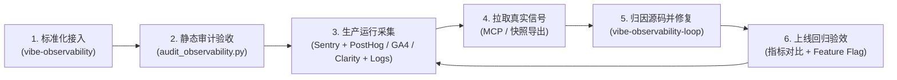

# vibe-observability

[](https://github.com/realchendahuang/vibe-observability/actions/workflows/ci.yml)
[](./LICENSE)

[English](./README.md) | [简体中文](./README_ZH.md)

**面向 Vibe Coding 产品的生产级可观测性 Agent Skills：一键接入全链路监控、防坑护栏，并打通“线上数据 → AI 自动诊断修复 → 效果回归”闭环。**

原生支持 **Antigravity**、**Claude Code**、**Codex**、**Cursor** 及所有兼容开放 `SKILL.md` 规范的 AI 编程代理。

---

## 为什么做这个项目？

Vibe Coding 让你几小时就能上线一个产品，但也最容易陷入**“上线后两眼一抹黑”**的困境。

圈内常说：*“让 AI 把 Sentry、PostHog、GA4、Microsoft Clarity 全接上，再把数据喂回给 AI，左脚踩右脚自动优化。”*

方向完全正确，但**如果直接让 AI 无脑把 4 个 SDK 塞进项目，会瞬间踩中 5 个工程深坑**：

| 无脑接入的常见深坑 | `vibe-observability` 的工程化解法 |
| :--- | :--- |
| **双录屏性能税** — 同时开启 PostHog 录屏 + Clarity + Sentry 录屏，会在浏览器挂多套 DOM MutationObserver，直接拖垮首屏和 Core Web Vitals。 | **互斥套餐分层（Profiles）**：`core` / `marketing` / `full-deduped` / `ai-app`，确保同一页面只启用一套录屏引擎。 |
| **前端视角盲区** — 接口 502、Stripe Webhook 失败或 SSL 证书过期时，浏览器 JS 根本跑不起来，前端看板一片绿但业务已挂。 | 补齐后端支柱：**结构化 JSON 日志**、`X-Request-Id` 链路关联、`/api/health` 轻探针与外部 Uptime 拨测清单。 |
| **裸调 SDK 满天飞 & 命名漂移** — 一会儿 `posthog.capture("clickBuy")`，一会儿 `gtag("event", "buy_btn")`，后面 AI 根本没法精准分析。 | 强制生成**类型安全的统一 `telemetry` 抽象层** + `object_action` 埋点词典 + **Sentry ↔ PostHog 跨工具关联**（报错直达录屏）。 |
| **AdBlock 丢数据、隐私违规与账单爆炸** — 30%–50% 科技用户拦统计脚本；GA4 传邮箱会被封号；一个 `useEffect` 死循环一晚打穿免费额度。 | 内置四重护栏：同源反向代理（`/ingest` + `/monitoring`）、PII 自动脱敏与 `maskAllInputs`、本地 `dev` 隔离、客户端突发限流与采样上限。 |
| **AI 拍脑袋“伪优化”** — 看着 5 个用户的噪音数据就乱改代码，改完也不知道指标到底涨没涨。 | 配套 **`vibe-observability-loop`** Skill：拉取真实证据 → 关联源码定根因 → 灰度/修复 → 强制产出上线后指标回归与回滚契约。 |

---

## “左脚踩右脚”数据驱动闭环



---

## 核心组件

### 两个互补的 Skills

1. **`skills/vibe-observability`（接入 + 工程护栏 + 验收）**
   - 自动探测项目技术栈（Next.js、Vite/React/Vue、Node、FastAPI、AI/LLM 应用）。
   - 自动推荐并落地最合适的互斥套餐（`core` / `marketing` / `full-deduped` / `ai-app`）。
   - 构建统一类型安全的 `telemetry` 封装层，打通 Sentry ↔ PostHog 录屏跳转、配置 `/ingest` 反向代理与隐私脱敏，补齐后端结构化日志与 `/api/health`。
   - 运行内置零依赖静态审计脚本 `scripts/audit_observability.py` 做上线前验收。

2. **`skills/vibe-observability-loop`（复盘 + 诊断 + 验效闭环）**
   - 支持 **MCP 实时直连**（Sentry MCP、PostHog MCP 等）和 **零配置快照粘贴**（报错堆栈、漏斗截图/CSV、Clarity 愤怒点击汇总）。
   - 按 `影响面 × 商业杠杆 × 置信度 ÷ 成本` 排序，优先处理阻塞登录/支付的 P0 故障和明确交互卡点。
   - 穿透到源码定位真实根因，输出带防回归测试的修复方案，并给出上线后 24h–7d 的指标验收和回滚阈值。

### 内置零依赖静态审计脚本

纯 Python 3.9+ 标准库实现，可在终端、AI Agent 或 CI 流水线里直接跑：

```bash
python3 skills/vibe-observability/scripts/audit_observability.py /path/to/your-app
# 输出 JSON 并在存在 HIGH/CRITICAL 问题时返回非零退出码：
python3 skills/vibe-observability/scripts/audit_observability.py /path/to/your-app --json --strict
```

自动检查项包括：
- `OBS-001` *(CRITICAL)*：源码硬编码 Sentry Auth Token / DSN / PostHog Key
- `OBS-002` / `OBS-002B` *(HIGH)*：双录屏冲突（PostHog 录屏 + Clarity / Sentry 录屏重叠）
- `OBS-003` *(HIGH)*：生产环境硬编码 `tracesSampleRate: 1.0`（账单爆雷风险）
- `OBS-004` *(HIGH)*：向 GA4 `gtag()` 传 PII 或开启 Sentry `sendDefaultPii: true`
- `OBS-005` *(MEDIUM)*：PostHog 录屏漏配 `maskAllInputs` 输入脱敏
- `OBS-006` / `OBS-006B` *(MEDIUM/LOW)*：缺少同源反向代理（`/ingest`）或 Next.js Sentry `tunnelRoute`
- `OBS-007` *(MEDIUM)*：业务组件多处裸调供应商 SDK，缺少统一抽象层
- `OBS-008` *(MEDIUM)*：代码引用的可观测性环境变量未写入 `.env.example`
- `OBS-009` *(LOW)*：PostHog 缺少 `person_profiles: 'identified_only'` 省钱配置
- `OBS-010` *(LOW)*：检测到后端 API 但缺少 `/api/health` 探针或结构化日志
- `OBS-011` *(INFO)*：客户端初始化未发现本地开发（dev）隔离开关

---

## 4 档互斥套餐矩阵

| 套餐 | 包含组件 | 适用场景 |
| :--- | :--- | :--- |
| **`core`** *（默认推荐）* | Sentry + PostHog + 后端日志 & `/health` | SaaS、独立 Web 应用、全栈 MVP |
| **`marketing`** | Sentry + GA4 + MS Clarity + `/health` | 落地页、SEO 内容站、广告投流漏斗 |
| **`full-deduped`** | Sentry + PostHog *（关录屏）* + GA4 + MS Clarity *（开录屏/热力图）* + 后端日志 | 既要深度产品漏斗/A/B 测试，又要 Google 广告归因与免费无限热力图的增长期产品 |
| **`ai-app`** | `core` + LLM 生成遥测（`$ai_generation`、TTFT、Token、成本、用户反馈） | AI 工具、Copilot、Agent、RAG 产品 |

---

## 快速安装

### 方式一：Clone 后运行 `install.sh`（推荐）

```bash
git clone https://github.com/realchendahuang/vibe-observability.git
cd vibe-observability

# 安装到 Antigravity (~/.gemini/config/skills)
./install.sh --target antigravity --symlink

# 安装到 Claude Code (~/.claude/skills)
./install.sh --target claude --symlink

# 安装到 Codex (~/.codex/skills)
./install.sh --target codex --symlink

# 安装到 Cursor (~/.cursor/skills)
./install.sh --target cursor --symlink

# 安装到通用 ~/.agents/skills 或一次性安装到全部全局目录
./install.sh --target agents --symlink
./install.sh --target all --symlink

# 安装到某个具体项目的 .agents/skills 目录
./install.sh --target project --project-dir /path/to/your-app --copy
```

### 方式二：通过 `skills` CLI 安装

```bash
npx skills add realchendahuang/vibe-observability
```

---

## 常用对话示例

安装后，直接像平时一样跟 AI 说话就会自动触发：

- **新项目一键拉满**：
  > “帮我用 `vibe-observability` 给这个项目把可观测性拉满，按我们的技术栈选最合适的套餐，接完跑一遍审计脚本验收。”
- **全量增长套件（自动去重防冲突）**：
  > “按 `full-deduped` 套餐接入 Sentry、PostHog、GA4 和 MS Clarity，建统一埋点封装层并配好 `/ingest` 反向代理。”
- **老项目体检排雷**：
  > “用 `vibe-observability` 审计一下当前仓库的埋点和监控，把隐私、账单和双录屏隐患修掉。”
- **上线后跑 AI 自动优化闭环**：
  > “用 `vibe-observability-loop` 分析一下最近的 Sentry 报错和 PostHog 漏斗流失，结合源码定位前 3 个根因并给出带上线验证指标的修复方案。”

---

## 本地测试

```bash
python3 -m unittest discover -s tests -v
```

## 开源协议

[MIT](./LICENSE)
