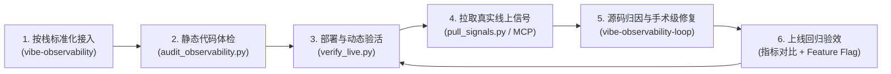

# vibe-observability

[](https://github.com/realchendahuang/vibe-observability/actions/workflows/ci.yml)
[](./LICENSE)

[English](./README.md) | [简体中文](./README_ZH.md)

**彻底框架中立的生产级可观测性 Agent Skills：全栈防坑接入 + 静态审计 + 上线后动态验活 + “左脚踩右脚” AI 数据闭环。**

原生覆盖 **现代 Web 全栈（Vite 8 / React / TanStack / Hono / Better Auth / Oxc）**、**Cloudflare 全家桶（Workers / D1 / KV / Queues / R2）**、**高并发自建基建（Go / Gin / Caddy / Pigsty / Prometheus / `pgmq` / OpenTelemetry）**、**跨平台桌面与原生端（Electron / Wails v3 / Tauri 2 / Swift / Kotlin）**、**SSR 框架（Next.js / Nuxt / SvelteKit / Astro）** 以及 **Python + `uv` 数据抓取与自动化脚本**。

支持 **Antigravity**、**Claude Code**、**Codex**、**Cursor** 及所有兼容开放 `SKILL.md` 规范的 AI 编程代理。

---

## 为什么做这个项目？

Vibe Coding 让你几小时就能上线一个产品，但也最容易陷入**“上线后两眼一抹黑”**的困境。

圈内常说：*“让 AI 把 Sentry、PostHog、GA4、Microsoft Clarity 全接上，再把数据喂回给 AI，左脚踩右脚自动优化。”*

方向完全对，但**如果无脑把 4 个 Web SDK 硬套到每个仓库里，马上会踩爆一堆真实生产大坑**：

| 常见 Vibe Coding 踩坑 | `vibe-observability` 的工程化解法 |
| :--- | :--- |
| **双录屏性能税** — 同时开 PostHog 录屏 + Clarity + Sentry 录屏，多套 DOM Observer 拖垮首屏和 Core Web Vitals。 | **7 档按运行形态互斥的套餐（Profiles）**：确保同一页面绝不重叠两套录屏。 |
| **跨端/边缘环境错配** — 在 Electron/Wails/Tauri 桌面端塞 GA4/Clarity 会坏协议还遭隐私差评；Cloudflare Workers 漏写 `ctx.waitUntil()` 会导致服务端事件 100% 丢失。 | **6 份按需加载的栈专属适配器**：精准适配 Vite/TanStack/Oxc、Cloudflare Workers、Go/Gin/Caddy/Pigsty、桌面/原生端、Python+`uv` 任务与 SSR 框架。 |
| **部署态隐形故障** — Auth Middleware 把 `/ingest` 307 重定向到 `/login`，或者 `.js.map` 直接公网泄露源码，静态扫代码根本看不出来。 | 内置 **`verify_live.py`** 上线后 3 秒动态冒烟验活：真发 HTTP 请求查 `/api/health`、`/ingest`、`/monitoring`、CSP 与 `.js.map` 泄露。 |
| **AdBlock 丢数、隐私违规与账单爆炸** — 30%–50% 科技用户拦统计脚本；GA4 传 PII 封号；一个 `useEffect` 死循环一晚打穿额度。 | 同源反向代理（Hono/Workers、Caddy、框架 rewrites）、严格 PII 脱敏、`oxlint` 禁止业务组件裸导 SDK、客户端突发限流与采样预算。 |
| **只停留在口号层的 AI 闭环** — 文档喊着“数据喂给 AI”，实际没法一键拉数，改完也不验证是否真涨了。 | 配套 **`vibe-observability-loop`** 内置零依赖只读 **`pull_signals.py`**（一键拉取 Sentry + PostHog HogQL + 本地作业 JSONL）+ MCP 接入指南 + 强制上线回归验效契约。 |

---

## 全链路闭环



---

## 内置 3 个零依赖 Python CLI 工具（仅用 Python 3.9+ 标准库）

### 1. 静态代码审计器（`audit_observability.py`）
覆盖 16 条高含金量规则（`OBS-001`–`OBS-016`），支持 TS/JS、Vue、Svelte、Go、Python、Rust、Swift、Kotlin、Wrangler、Caddyfile、Oxc：

```bash
python3 skills/vibe-observability/scripts/audit_observability.py /path/to/repo
python3 skills/vibe-observability/scripts/audit_observability.py /path/to/repo --json --strict
```

自动揪出：硬编码密钥/DSN、双录屏冲突、`tracesSampleRate: 1.0`、向 GA4 传 PII、缺 `maskAllInputs`/`person_profiles`/`/ingest` 反代、业务组件散落裸调 SDK、漏写 `.env.example`、桌面/原生端误装 GA4/Clarity（`OBS-012`）、Workers/Serverless 漏 `shutdown()/waitUntil()`（`OBS-013`）、Middleware 漏排 `/ingest` 或 `/monitoring`（`OBS-014`）、Source Map 上传后漏删（`OBS-015`）、Cloudflare Workers 误用 `@sentry/node`（`OBS-016`）。

### 2. 上线后动态冒烟验证器（`verify_live.py`）
专抓部署态才能暴露的惨案：

```bash
python3 skills/vibe-observability/scripts/verify_live.py https://app.example.com --strict
```

实时检查：首页可达性与 HTTPS、`/api/health` 或 `/healthz` 延迟、`/ingest/static/array.js` 是否被登录中间件 302/307 拦截或被 SPA 吞成 HTML、`/monitoring` Sentry Tunnel 状态、**公网 `.js.map` 源码泄露（`CRITICAL`）** 以及 CSP 兼容性。

### 3. 只读线上信号拉取器（`pull_signals.py`）
不强依赖装一堆 MCP，用只读 Token 一键生成紧凑的 AI 诊断简报（绝不打印 Token）：

```bash
python3 skills/vibe-observability-loop/scripts/pull_signals.py --days 7
python3 skills/vibe-observability-loop/scripts/pull_signals.py --days 7 --job-history ./logs/runs.jsonl
```

自动汇总 Sentry 按影响用户数排序的未解决 Top Issues、PostHog HogQL 核心事件与 `$ai_generation` 大模型延迟/Token 消耗，以及本地 Python 抓取任务的静默降级/异常记录。

---

## 7 档运行形态套餐矩阵

| 套餐 | 核心组合 | 适用场景 |
| :--- | :--- | :--- |
| **`core`** *（默认 Web）* | Sentry + PostHog + 结构化日志 & `/health` | Vite/React/TanStack/Hono、Next.js/Nuxt、SaaS MVP |
| **`marketing`** | Sentry + GA4 + MS Clarity + `/health` | 落地页、SEO 内容站、Google 广告投流 |
| **`full-deduped`** | Sentry + PostHog *（关录屏）* + GA4 + MS Clarity *（开录屏）* + 日志 | 既要产品漏斗/Feature Flag 又要广告归因与免费热力图 |
| **`ai-app`** | `core` + LLM 生成遥测（`$ai_generation`、TTFT、Token、成本、反馈） | AI 工具、Copilot、Agent、RAG 产品 |
| **`selfhosted-infra`** | Go `log/slog` + Sentry + `/metrics`（并入 Pigsty Prometheus/Grafana/Loki）+ Caddy `/ingest` + `pgmq` 堆积告警 | 独立服务器、Go + Gin + Docker + Caddy + Pigsty（`pgmq`/Valkey/RustFS） |
| **`desktop-native`** | 原生崩溃上报（`@sentry/electron` / `sentry-go` / `sentry` Rust / `sentry-cocoa`+`MetricKit` / `sentry-android`）+ 本地滚动诊断日志 + 可关闭匿名事件 | Electron、Wails v3、Tauri 2、Swift（macOS/iOS）、Kotlin（Android）— **严禁 GA4/Clarity** |
| **`batch-jobs`** | `structlog` JSON + Sentry Crons 死人开关 + Run Summary 与抓取量骤降告警 | Python + `uv` 抓取脚本、Ego Lite 自动化、定时 ETL |

---

## 快速安装

`skills/` 下的每个 Skill 目录均**完全自包含**（含参考文档、样板代码与零依赖脚本），拷贝或 CLI 安装均不丢文件。

### 方式一：Clone 后运行 `install.sh`（推荐）

```bash
git clone https://github.com/realchendahuang/vibe-observability.git
cd vibe-observability

# Antigravity (~/.gemini/config/skills)
./install.sh --target antigravity --symlink

# Claude Code / Codex / Cursor / 全部全局目录
./install.sh --target claude --symlink
./install.sh --target codex --symlink
./install.sh --target cursor --symlink
./install.sh --target all --symlink

# 安装到单个项目的 .agents/skills
./install.sh --target project --project-dir /path/to/your-app --copy
```

### 方式二：通过 `skills` CLI 安装

```bash
npx skills add realchendahuang/vibe-observability
```

---

## 本地测试

```bash
python3 -m unittest discover -s tests -v
```

## 开源协议

[MIT](./LICENSE)
