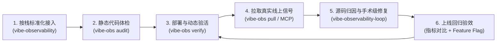

# vibe-observability

[](https://github.com/realchendahuang/vibe-observability/actions/workflows/ci.yml)
[](https://github.com/realchendahuang/vibe-observability/releases)
[](./LICENSE)

[English](./README.md) | [简体中文](./README_ZH.md)

**面向 Vibe Coding 与现代全栈项目的中立可观测性护栏、零依赖 CLI 验证工具与“左脚踩右脚” AI 闭环 Agent Skills。**

原生覆盖 **现代 Web 全栈（Vite 8 / React / TanStack / Hono / Better Auth / Oxc）**、**Cloudflare 全家桶（Workers / D1 / KV / Queues / R2）**、**高并发自建基建（Go / Gin / Caddy / Pigsty / Prometheus / `pgmq` / OpenTelemetry）**、**跨平台桌面与原生端（Electron / Wails v3 / Tauri 2 / Swift / Kotlin）**、**SSR 框架（Next.js / Nuxt / SvelteKit / Astro）** 以及 **Python + `uv` 数据抓取与自动化脚本**。

兼容 **Antigravity**、**Claude Code**、**Codex**、**Cursor** 及所有支持开放 `SKILL.md` 规范的 AI 编程代理。

---

## 3 秒免安装体验（`uvx` 一行命令）

甚至不用先安装 Agent Skills，零第三方运行时依赖，一行命令就能直接体检你手头的项目或验证线上部署：

```bash
# 1. 静态体检本地任意项目（自动检查 16 条高发可观测性隐患）
uvx --from git+https://github.com/realchendahuang/vibe-observability vibe-obs audit .

# 2. 上线后 3 秒动态冒烟验活（揪出 /ingest 被登录拦截 307、.js.map 源码公网泄露）
uvx --from git+https://github.com/realchendahuang/vibe-observability vibe-obs verify https://app.example.com

# 3. 只读一键拉取近 7 天线上信号简报（Sentry + PostHog + Clarity + Prometheus/Pigsty + 本地作业）
uvx --from git+https://github.com/realchendahuang/vibe-observability vibe-obs pull --days 7
```

### 真实终端实战效果

```text
$ vibe-obs audit ./my-web-app --strict
Vibe Observability Audit — /workspace/my-web-app
====================================================================
Files scanned : 48
Providers     : sentry, posthog, ga4, clarity
Stack hints   : vite, oxlint, backend
Score         : 10/100  (CRITICAL=0 HIGH=3 MEDIUM=3 LOW=1 INFO=0)

[HIGH] OBS-002: Dual session-replay conflict: PostHog Replay + Microsoft Clarity both active
  Fix : Set `disable_session_recording: true` in `posthog.init(...)`, or drop Clarity.
[HIGH] OBS-003: Unbounded Sentry tracing sample rate (100%)
  Fix : Use an environment-aware sample rate such as `0.1` in production and `0` in dev.
[HIGH] OBS-004: Potential PII forwarded to GA4 or Sentry default PII capture enabled
  Fix : Set `sendDefaultPii: false` in Sentry and never pass email/phone/name into `gtag()`.

$ vibe-obs verify https://app.example.com --strict
[PASS]     LIVE-001: Homepage healthy (HTTP 200) (118ms)
[PASS]     LIVE-002: Health probe healthy (HTTP 200 in 24ms)
[HIGH]     LIVE-003: PostHog proxy redirected (HTTP 307 -> /login)
[CRITICAL] LIVE-005: Public source maps exposed (1 file(s)) -> /assets/app.js.map
```

---

## 为什么做这个项目？

厂商官方插件只教你怎么装*自家* SDK，绝不会提醒你：同时开 PostHog 录屏 + Clarity + Sentry 录屏会把首屏卡死；在 Electron/Wails/Tauri 桌面端塞 GA4/Clarity 会坏协议并引发用户隐私反感；Cloudflare Workers 漏写 `ctx.waitUntil()` 会让服务端事件 100% 丢失；或者你用 Pigsty 时早就自带了 Prometheus + Grafana + Loki 没必要花冤枉钱买 APM。

| 常见 Vibe Coding 踩坑 | `vibe-observability` 的工程化解法 |
| :--- | :--- |
| **双录屏性能税** — 多套 DOM Observer 拖垮首屏和 Core Web Vitals。 | **7 档按运行形态互斥的套餐（Profiles）**：确保同一页面只开一套录屏。 |
| **跨端/边缘环境错配** — 桌面端硬装 GA4/Clarity；Workers 误用 `@sentry/node` 或漏 `ctx.waitUntil()`。 | **6 份按需加载的栈专属适配器**：按真实运行环境提供精准防坑规范。 |
| **部署态隐形故障** — Auth Middleware 把 `/ingest` 307 跳去 `/login`，或 `.js.map` 公网泄露源码。 | **`vibe-obs verify`** 上线后真发请求检查 `/api/health`、`/ingest`、`/monitoring`、CSP 与 `.js.map`。 |
| **AdBlock 丢数、隐私违规与账单爆炸** — 30%–50% 流量被拦；GA4 传 PII 封号；`useEffect` 死循环打爆额度。 | 同源反向代理（Hono/Workers、Caddy、框架 rewrites）、PII 脱敏、`oxlint` 封装护栏、客户端突发限流与采样预算。 |
| **只喊口号的 AI 优化闭环** — 盯着噪音数据拍脑袋改代码，改完也不验收。 | 配套 **`vibe-observability-loop`** 用 **`vibe-obs pull`** / MCP 拉真实数据，穿透源码定根因，强制输出上线回归契约。 |

---

## 全链路数据驱动闭环



---

## 可复现量化对比基准（`evals/`）

本地运行 `python3 evals/run_benchmark.py` 即可 100% 复现以下对比（常见无脑 AI 接入 vs 本项目 5 套自包含参考样板）：

| 类别 | 场景 | 审计得分 | Critical/High | 触发规则 |
| :--- | :--- | :---: | :---: | :--- |
| 优化前（Naive） | 无脑全装 4 家 SDK 的 Web 应用 | **0/100** | 3 | OBS-002, OBS-003, OBS-004, OBS-005, OBS-006, OBS-007, OBS-008, OBS-009, OBS-011 |
| 优化前（Naive） | 误用 `@sentry/node` 且漏 `waitUntil` 的 Workers | **25/100** | 3 | OBS-003, OBS-013, OBS-016, OBS-008, OBS-010, OBS-011 |
| 优化前（Naive） | 误装 Web Clarity + GA4 的桌面 Tauri 应用 | **50/100** | 2 | OBS-004, OBS-012, OBS-008, OBS-011 |
| 优化后（`vibe-observability`） | 样板：`vite-tanstack-hono` | **100/100** | 0 | None (PASS) |
| 优化后（`vibe-observability`） | 样板：`cloudflare-workers-hono` | **100/100** | 0 | None (PASS) |
| 优化后（`vibe-observability`） | 样板：`go-gin-caddy` | **100/100** | 0 | None (PASS) |
| 优化后（`vibe-observability`） | 样板：`python-uv-job` | **100/100** | 0 | None (PASS) |
| 优化后（`vibe-observability`） | 样板：`nextjs-app-router` | **100/100** | 0 | None (PASS) |

---

## 内置 3 个零依赖 CLI 工具（仅用 Python 3.9+ 标准库）

全部工具既可通过 **`vibe-obs <子命令>`**（`uvx` 或包安装）调用，也可直接单独执行 `skills/*/scripts/*.py`。

1. **`audit`（`audit_observability.py`）** — 覆盖 `OBS-001`–`OBS-016`，支持 TS/JS、Vue、Svelte、Go、Python、Rust、Swift、Kotlin、Wrangler、Caddyfile、Oxc。
   - 支持 CI 严格门禁（`--strict` / `--fail-on HIGH`）、`--json` 输出，以及通过 `--ignore OBS-006B,OBS-010` 或项目根 `.vibe-observability.json` 配置白名单：
     ```json
     {
       "ignore": ["OBS-006B", "OBS-010"],
       "exclude_paths": ["legacy/", "scripts/scratch/"]
     }
     ```
2. **`verify`（`verify_live.py`）** — 上线后动态验活，检查首页与 HTTPS、`/api/health` 或 `/healthz`、`/ingest/static/array.js`（抓 302/307 登录跳转和 SPA HTML 兜底）、`/monitoring` Tunnel、公网 `.js.map` 源码泄露（`CRITICAL`）及 CSP 头。
3. **`pull`（`pull_signals.py`）** — 严格只读信号聚合器，一键汇总 Sentry 未解决 Top Issues、PostHog HogQL 核心事件与 `$ai_generation` 延迟/Token、Microsoft Clarity 实时摩擦指标（Rage/Dead Clicks）、Prometheus/Pigsty PromQL 指标（宕机节点、`pgmq` 堆积与滞留时间）以及本地 Python 抓取 JSONL 异常——绝不输出 Token。

---

## 7 档运行形态套餐矩阵

| 套餐 | 核心组合 | 适用场景 |
| :--- | :--- | :--- |
| **`core`** *（默认 Web）* | Sentry + PostHog + 结构化日志 & `/health` | Vite/React/TanStack/Hono、Next.js/Nuxt、SaaS MVP |
| **`marketing`** | Sentry + GA4 + MS Clarity + `/health` | 落地页、SEO 内容站、Google 广告投流 |
| **`full-deduped`** | Sentry + PostHog *（关录屏）* + GA4 + MS Clarity *（开录屏）* + 日志 | 既要产品漏斗/Feature Flag 又要广告归因与免费热力图 |
| **`ai-app`** | `core` + LLM 生成遥测（`$ai_generation`、TTFT、Token、成本、反馈） | AI 工具、Copilot、Agent、RAG 产品 |
| **`selfhosted-infra`** | Go `log/slog` + Sentry + `/metrics`（并入 Pigsty Prometheus/Grafana/Loki）+ Caddy `/ingest` + `pgmq` 堆积告警 | 独立服务器、Go + Gin + Docker + Caddy + Pigsty（`pgmq`/Valkey/RustFS） |
| **`desktop-native`** | 原生崩溃上报（`@sentry/electron` / `sentry-go` / `sentry` Rust / `sentry-cocoa`+`MetricKit` / `sentry-android`）+ 本地滚动诊断日志 + 可关闭匿名事件 | Electron、Wails v3、Tauri 2、Swift（macOS/iOS）、Kotlin（Android）— **严禁 GA4/Clarity** |
| **`batch-jobs`** | `structlog` JSON + Sentry Crons 死人开关 + Run Summary 与抓取量骤降告警 | Python + `uv` 抓取脚本、Ego Lite 自动化、定时 ETL |

---

## 安装 Agent Skills

`skills/` 下的每个 Skill 目录均**完全自包含**（含参考文档、样板代码与零依赖脚本），拷贝或 CLI 安装均不丢文件。

### 方式一：Clone 后运行 `install.sh`（推荐）

```bash
git clone https://github.com/realchendahuang/vibe-observability.git
cd vibe-observability

./install.sh --target antigravity --symlink   # ~/.gemini/config/skills
./install.sh --target claude --symlink        # ~/.claude/skills
./install.sh --target codex --symlink         # ~/.codex/skills
./install.sh --target cursor --symlink        # ~/.cursor/skills
./install.sh --target all --symlink           # 全部全局目录

# 安装到单个项目的 .agents/skills
./install.sh --target project --project-dir /path/to/your-app --copy
```

### 方式二：通过 `skills` CLI 安装

```bash
npx skills add realchendahuang/vibe-observability
```

---

## 常用对话示例

- **新项目一键拉满**：*“帮我用 `vibe-observability` 给这个项目把可观测性拉满，按技术栈选最合适的套餐，建统一封装层，接完用 `audit_observability.py --strict` 验收。”*
- **老项目排雷体检**：*“用 `vibe-observability` 审计一下当前仓库的埋点和监控，修掉所有 CRITICAL/HIGH 级别的隐私、账单、反代或双录屏问题。”*
- **上线后动态验活**：*“跑一下 `verify_live.py https://app.example.com --strict`，把拦截 `/ingest` 或泄露 `.js.map` 的配置修掉。”*
- **启动 AI 自动优化闭环**：*“用 `vibe-observability-loop` 拉一下最近 7 天的 Sentry、PostHog 和 Clarity 信号，结合源码定位前 3 个根因，并输出带上线验证指标的修复方案。”*

---

## 仓库目录结构

```text
vibe-observability/
├── pyproject.toml                                  # 零依赖 `vibe-obs` CLI 打包配置（支持 uvx）
├── src/vibe_observability/cli.py                   # 单一事实来源 CLI 分发器
├── install.sh                                      # 跨 Agent 安装脚本（软链 / 拷贝 / 卸载）
├── skills/
│   ├── vibe-observability/                         # 完全自包含 Skill 1：接入、审计与动态验活
│   │   ├── SKILL.md
│   │   ├── references/                             # 通用护栏手册 + 6 份全栈适配器
│   │   ├── examples/                               # 5 套即拷即用样板（审计全 100/100）
│   │   └── scripts/
│   │       ├── audit_observability.py              # 静态审计器（OBS-001..016）
│   │       └── verify_live.py                      # 上线后动态验活器（LIVE-001..006）
│   └── vibe-observability-loop/                    # 完全自包含 Skill 2：拉数 → 归因 → 修复 → 验效
│       ├── SKILL.md
│       ├── references/                             # MCP/API 接入、根因诊断手册、回归验效契约
│       └── scripts/
│           └── pull_signals.py                     # 只读信号拉取器（Sentry/PostHog/Clarity/Prometheus/Job）
├── evals/                                          # 可复现的前后对比基准测试
├── tests/                                          # 零警告单测、本地 Mock HTTP 与 CLI 测试
├── CONTRIBUTING.md / SECURITY.md / CHANGELOG.md
```

---

## 本地测试与安全说明

```bash
python3 -W error -m unittest discover -s tests -v
python3 evals/run_benchmark.py
```

详见 [CONTRIBUTING.md](./CONTRIBUTING.md)、[SECURITY.md](./SECURITY.md) 与 [CHANGELOG.md](./CHANGELOG.md)。

## 开源协议

[MIT](./LICENSE)
